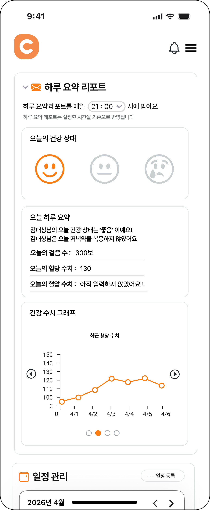
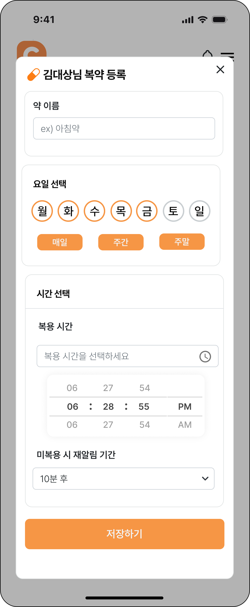
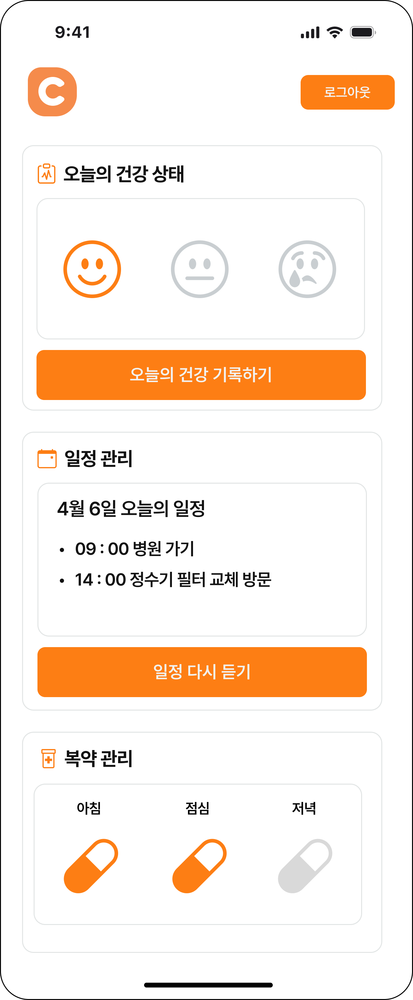

# Caring (Back-End)

보호자와 돌봄대상자(어르신)를 연결하는 돌봄 앱 Caring의 백엔드 서버입니다.
보호자가 등록한 복약과 일정을 정해진 시간에 음성 알림으로 전달하고,
돌봄대상자가 응답하지 않으면 보호자에게 알려 줍니다.
위치 확인, 건강 기록, 일일 리포트, 주변 복지시설 안내 기능도 제공합니다.

- 원본 저장소: https://github.com/Caring-App/Caring-BackEnd
- 프론트엔드 저장소 (React Native): https://github.com/Caring-App/Caring-FrontEnd

## 개요

| 항목 | 내용 |
| --- | --- |
| 기간 | 2026.04 ~ 2026.10 (약 6개월) |
| 인원 | 4명 (이세연, 이나연, 조혜인, 차기호) |
| 담당 | 기여도 약 45%<br>- 복약 알림 (복약 일정 API, 알림/재알림 스케줄러, 보호자 미응답 알림)<br>- TTS 음성 알림 (Google Cloud TTS 합성, Firebase Storage 저장, 음성 속도 설정)<br>- 일정 관리 (일정 API, 일정 알림 스케줄러)<br>- 위치 기반 방문 확인 (GPS 수신, 장소 등록, 방문 자동 판독)<br>- 복지시설 조회 (공공데이터 API, 카카오 좌표 변환, 캐싱)<br>- 회원/인증 일부 (JWT 발급, 비밀번호 암호화, SMS 인증, 보호자 연동 코드) |

## 기술 스택

| 분류 | 기술 |
| --- | --- |
| Language | Java 21 |
| Framework | Spring Boot 4.0, Spring Data JPA, Spring Security, Validation |
| Database | MySQL |
| Auth | JWT (jjwt) |
| Push / Storage | Firebase Cloud Messaging, Firebase Storage |
| External API | Google Cloud Text-to-Speech, 카카오 로컬 API, 공공데이터포털 복지시설 API, CoolSMS, Gemini API |
| Docs | Swagger (springdoc-openapi) |
| Build / Tool | Gradle, IntelliJ IDEA, Git, GitHub |

## 주요 기능

- 회원가입/로그인: 보호자와 돌봄대상자 회원가입, SMS 인증, JWT 기반 인증
- 보호자 연동: 보호자 고유 코드로 돌봄대상자와 연결
- 복약 관리: 복약 일정 등록, 정해진 시간에 음성 알림, 미응답 시 재알림 후 보호자에게 알림
- 일정 관리: 병원 방문 등 일정 등록과 음성 알림
- 위치 확인: 돌봄대상자 위치 수신, 등록한 장소 방문 여부 자동 확인
- 건강 기록: 기분 체크, 걸음 수 등 건강 기록과 그래프
- 일일 리포트: 하루 기록을 요약한 리포트 제공
- 복지시설 안내: 돌봄대상자 주소 근처의 복지시설 조회
- 알림함, 마이페이지, 대상자 설정(글자 크기, 음성 속도), 약관, 문의

## 프로젝트 구조

도메인별로 패키지를 나누고, 여러 도메인에서 함께 쓰는 기능은 `global`에 두었습니다.

```
src/main/java/com/caring
├── domain
│   ├── member            회원가입, 로그인, 마이페이지
│   ├── connection        보호자-돌봄대상자 연동
│   ├── pill              복약 일정, 복약 기록
│   ├── schedule          일정
│   ├── location          위치 기록, 장소
│   ├── notification      FCM 발송, 알림함
│   ├── setting           대상자 설정 (글자 크기, 음성 속도)
│   ├── welfarefacility   복지시설
│   ├── health            건강 기록
│   ├── report            일일 리포트
│   ├── policy            약관
│   └── inquiry           문의
└── global
    ├── scheduler         복약/일정 알림 스케줄러
    ├── tts               Google Cloud TTS 합성
    ├── file              음성 파일 업로드/삭제 (Firebase Storage)
    ├── geocoding         카카오 주소-좌표 변환
    ├── welfareapi        공공데이터 복지시설 API
    ├── sms               CoolSMS 발송
    ├── jwt               JWT 발급/검증
    └── config, exception, common
```

## 데이터베이스

보호자와 돌봄대상자는 모두 `member` 테이블에 저장하고, `connection`으로 둘을 연결했습니다.
돌봄 데이터(복약, 일정, 위치, 건강, 리포트)는 모두 돌봄대상자(`ward_id`)를 기준으로 연결됩니다.

```
member (보호자) ─┐
                 ├─ connection
member (대상자) ─┘
      │
      ├─ pill_schedule ── pill_log
      ├─ task_schedule ── place_info
      ├─ place_info
      ├─ location_log
      ├─ ward_setting
      ├─ member_disease ── disease
      ├─ health_record, step_record, mood_check
      ├─ report_setting
      ├─ daily_report ── daily_report_health_detail
      ├─ notification_log
      └─ inquiry

policy, welfare_facility (독립 테이블)
```

| 분류 | 테이블 | 설명 |
| --- | --- | --- |
| 회원 | member | 보호자/돌봄대상자 계정, 역할, 주소와 좌표, FCM 토큰 |
| | connection | 보호자와 돌봄대상자 연동 관계 |
| | ward_setting | 대상자별 글자 크기, TTS 음성 속도 |
| 복약 | pill_schedule | 복약 일정 (약 종류, 시간, 요일, 재알림 간격, 음성 파일 URL) |
| | pill_log | 날짜별 복약 기록 (복약 여부, 재알림 횟수) |
| 일정/위치 | task_schedule | 일정 (시간, 장소, 음성 파일 URL) |
| | place_info | 보호자가 등록한 장소 (좌표) |
| | location_log | 대상자 위치 기록, 체류 시간, 방문 확인 여부 |
| 건강/리포트 | disease, member_disease | 질환 목록, 대상자별 질환 |
| | health_record, step_record, mood_check | 건강 수치, 걸음 수, 기분 체크 |
| | report_setting, daily_report, daily_report_health_detail | 리포트 설정, 일일 리포트 |
| 기타 | notification_log | 알림함 (수신자, 내용, 읽음 여부) |
| | welfare_facility | 복지시설 캐시 (좌표, 연락처, 갱신 시각) |
| | policy, inquiry | 약관, 문의 |


## 담당 업무

### 1. 복약 알림

복약 일정 등록부터 알림, 재알림, 보호자 알림까지 이어지는 흐름을 구현했습니다.

```
복약 시간 도달 → 돌봄대상자에게 음성 알림 (FCM)
   └ 미응답 → 설정한 간격(기본 10분)마다 재알림
        └ 재알림 2회 후에도 미응답 → 보호자에게 미응답 알림 + 알림함 기록
복약 확인 시 → 보호자에게 복약 완료 알림
```

- 복약 일정 CRUD API (약 종류, 복용 시간, 요일, 재알림 간격, 알림 방식)
- 매분 실행되는 스케줄러로 복약 시간이 된 일정을 찾아 알림을 보내고, 날짜별 복약 기록(`PillLog`)으로 재알림 횟수와 응답 여부 관리
- 보호자가 다른 대상자의 일정에 접근하지 못하도록 연동 관계 기반 인가 검사 추가
- 보호자의 푸시 수신 설정을 확인해 알림 발송 여부 결정

### 2. TTS 음성 알림

어르신이 화면을 보지 않아도 알림 내용을 들을 수 있도록 음성 알림을 구현했습니다.

- 복약/일정 등록 시 알림 문구를 Google Cloud TTS로 합성해 Firebase Storage에 저장하고, FCM 데이터 메시지에 음성 파일 URL을 담아 전달
- 재알림용 음성도 등록 시점에 미리 합성해 알림 시점의 지연 제거
- 대상자별 음성 속도 설정을 합성에 반영하고, 속도를 바꾸면 등록된 복약/일정 음성을 일괄 재합성
- 보호자가 직접 녹음한 음성 파일 업로드 API 제공, 알림 방식과 음성 파일의 정합성 검증
- 복약/일정을 수정하거나 삭제할 때 이전 음성 파일을 Storage에서 함께 삭제해 불필요한 파일이 쌓이지 않도록 처리

### 3. 일정 관리

- 일정 CRUD API, 기간 조회(startDate ~ endDate), 돌봄대상자 본인의 오늘 일정 조회 API
- 일정 시간에 맞춰 음성 알림을 보내는 스케줄러 구현

### 4. 위치 기반 방문 확인

- 돌봄대상자 앱에서 보내는 GPS 위치를 저장하고, 보호자가 최근 위치를 조회하는 API 구현
- 보호자가 등록한 장소(병원 등) 반경 100m 안에 5분 이상 연속으로 머물면 방문으로 판단
  - 최근 30분 위치 기록을 최신순으로 확인하다가 반경을 벗어난 기록이 나오면 멈추는 방식으로 연속 체류 시간 계산

### 5. 복지시설 조회

- 회원 주소를 카카오 로컬 API로 좌표 변환하고, 공공데이터포털 복지시설 API로 주변 시설을 조회해 거리순으로 제공
- 조회한 시설 정보를 DB에 캐싱하고, 6개월이 지난 데이터만 다시 조회해 외부 API 호출 감소

### 6. 회원/인증 및 기타

- 초기 DB 스키마 설계
- 로그인 시 JWT Access/Refresh Token 발급, 비밀번호 BCrypt 암호화
- CoolSMS를 이용한 SMS 인증번호 발송과 회원가입 연동
- 보호자 고유 코드 생성, 보호자 연동 여부 확인 API
- 대상자 설정, 마이페이지 내 정보 조회와 주소 수정, 약관 조회 API
- 알림함(알림 기록 조회, 읽음 처리) 구현

## 화면

앱 화면은 프론트엔드 팀원이 구현했으며, 백엔드 API와 연동된 결과입니다.

| 보호자 홈 | 복약 관리 | 돌봄대상자 메인 |
| --- | --- | --- |
|  |  |  |

## 트러블슈팅

### 1. 복약 재알림 횟수가 증가하지 않는 문제

- 문제: 복약 재알림을 보낸 뒤에도 재알림 횟수가 그대로여서, 정해진 횟수 후 보호자에게 알림이 가지 않았습니다.
- 원인: 스케줄러 메서드에 트랜잭션이 없어, 조회한 엔티티의 값을 바꿔도 JPA 변경 감지가 동작하지 않고 DB에 반영되지 않았습니다. 또한 횟수 증가 코드가 FCM 발송 `try` 블록 안에 있어서, 발송이 실패하면 횟수가 올라가지 않았습니다.
- 해결: 스케줄러 메서드에 `@Transactional`을 적용하고, 횟수 증가를 `finally` 블록으로 옮겨 발송 성공 여부와 관계없이 재알림 횟수가 기록되도록 했습니다.

### 2. 복약 시간을 수정하면 재알림이 오지 않는 문제

- 문제: 당일 복약 시간을 수정하면 새 시간에 알림은 오지만, 이후 재알림이 오지 않았습니다.
- 원인: 재알림 횟수는 날짜별 복약 기록에 저장되는데, 수정 전 시간 기준으로 쌓인 횟수와 상태가 그대로 남아 새 시간의 재알림 시각 계산이 어긋났습니다.
- 해결: 복약 일정을 수정할 때 당일 기록이 아직 복약 확인 전이면 재알림 횟수와 상태를 초기화하도록 했습니다.

### 3. 복지시설 최초 조회 응답이 느린 문제

- 문제: 처음 조회하는 지역은 응답이 매우 느렸습니다.
- 원인: 공공데이터 API가 주는 시설 주소를 시설마다 하나씩 순서대로 카카오 API로 좌표 변환하고 있었습니다.
- 해결: 캐시에 없는 시설만 골라 좌표 변환을 `parallelStream`으로 병렬 처리하고, 결과는 `ConcurrentHashMap`에 모았습니다. DB 저장은 JPA 영속성 컨텍스트가 스레드 간에 안전하지 않기 때문에 순차로 처리하도록 단계를 나눴습니다.


## 실행 방법

1. MySQL에 `caringdb` 데이터베이스 생성
2. Firebase 서비스 계정 키, Google Cloud TTS, 카카오, 공공데이터포털, CoolSMS, Gemini API 키 발급
3. `src/main/resources/application-secret.yml` 작성 (보안을 위해 레포에는 포함하지 않음)

```yaml
jwt:
  secret:
  access-token-expiry:
  refresh-token-expiry:
firebase:
  storage-bucket:
kakao:
  rest-api-key:
welfare-api:
  service-key:
coolsms:
  api-key:
  api-secret:
  sender:
gemini:
  api-key:
```

4. 환경 변수 `DB_USERNAME`, `DB_PASSWORD` 설정 후 실행

```bash
./gradlew bootRun
```

5. API 문서: http://localhost:8080/swagger-ui/index.html

## 회고

- 정해진 시간에 동작해야 하는 알림 기능을 만들면서, 스케줄러와 트랜잭션, 외부 API 실패를 함께 고려해야 데이터가 어긋나지 않는다는 것을 배웠습니다.
- TTS, FCM, Firebase Storage, 공공데이터 API 등 여러 외부 서비스를 연동하며, 외부 호출을 언제 하고 결과를 어디에 저장할지에 따라 응답 속도와 비용이 크게 달라진다는 것을 경험했습니다.
- API 키와 비밀번호를 별도 설정 파일과 환경 변수로 분리하고, 기능을 브랜치 단위로 나눠 PR로 협업하는 방식을 익혔습니다.
- 아쉬운 점은 매분 실행되는 스케줄러가 서버 한 대를 전제로 하고 있다는 점입니다. 서버를 여러 대로 늘리면 알림이 중복 발송될 수 있어, 분산 락 등을 적용해 개선하고 싶습니다.

## 문서

- [Caring 최종보고서](./docs/caring-final-report.pdf)
